<div align="center">


<a href="https://github.com/pratikgodase07/PMIS">
  
</a>

<br/>


**[Features](#-features) · [Quick Start](#-quick-start) · [Architecture](#-architecture) · [Rules](#-business-rules) · [Screenshots](#-live-demo) · [Team](#-meet-the-team)**

</div>


## ✨ Features

<table>
<tr>
<td width="33%" valign="top">

### 🚌 Fleet Management
Onboard shuttles with driver and battery level, and view the full inventory dashboard.

</td>
<td width="33%" valign="top">

### 🔋 Smart Battery Rules
Each trip uses **10%** battery. Drop below **15%** and the shuttle goes to maintenance automatically.

</td>
<td width="33%" valign="top">

### 📊 Joined Analytics
Trips and passengers per shuttle, built with a multi-table `LEFT JOIN`.

</td>
</tr>
<tr>
<td valign="top">

### 🗺️ Route Logging
Log completed trips against campus stops, from North Gate to the Sports Arena.

</td>
<td valign="top">

### 🛠️ Maintenance Override
Dispatchers can pull any vehicle off the road, then recharge and release it.

</td>
<td valign="top">

### 🔌 Zero-Setup Database
Runs on MySQL, and **falls back to in-memory H2** if MySQL isn't available.

</td>
</tr>
</table>


## 🚀 Quick Start

> **Prerequisites:** JDK 17. MySQL 8.x is optional.

```bash
# 1. Clone and enter the project
git clone https://github.com/pratikgodase07/PMIS.git
cd PMIS/November_2nd/Smart-Campus-EV-Shuttle-Tracker---Group-1

# 2. Run it (macOS / Linux)
./mvnw spring-boot:run

# ...or on Windows
mvnw.cmd spring-boot:run
```

That's it. No MySQL? The app waits about 2 seconds, then switches to in-memory H2 and keeps going.

<details>
<summary><b>🗄️ Want to use MySQL? Click to expand</b></summary>

<br/>

Create the database:

```sql
CREATE DATABASE IF NOT EXISTS shuttle_tracker;
```

Then match the credentials in `src/main/resources/application.properties`:

```properties
spring.datasource.url=jdbc:mysql://localhost:3306/shuttle_tracker?useSSL=false&serverTimezone=UTC&allowPublicKeyRetrieval=true
spring.datasource.username=root
spring.datasource.password=root
```

> ⚠️ `schema.sql` **drops and recreates** all tables on every start (`spring.sql.init.mode=always`), so data resets on each run.

</details>

<details>
<summary><b>📦 Build a runnable JAR</b></summary>

<br/>

```bash
./mvnw clean package
java -jar target/smart-campus-ev-shuttle-tracker-1.0.0-SNAPSHOT.jar
```

</details>


## 🏛️ Architecture

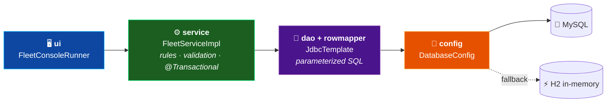

### 🔄 Shuttle status lifecycle

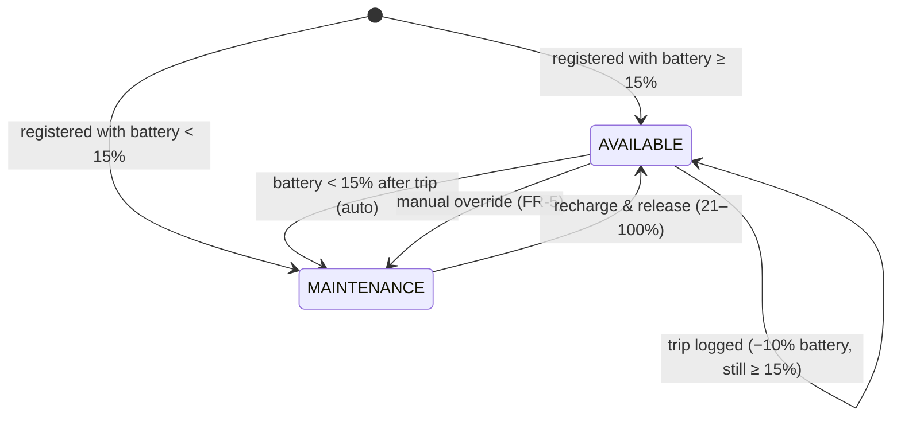

### 🚏 What happens when you log a trip

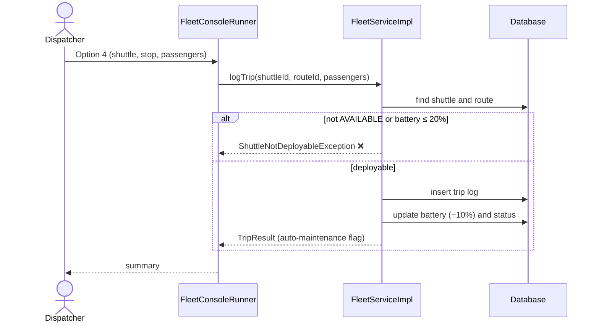

<details>
<summary><b>📂 Full project structure</b></summary>

<br/>

```
Smart-Campus-EV-Shuttle-Tracker---Group-1/
├── pom.xml                                         # Maven build (Spring Boot 3.2.5, Java 17)
├── mvnw / mvnw.cmd                                 # Maven wrapper scripts
├── .mvn/wrapper/maven-wrapper.properties
├── .gitignore
├── README.md
├── team-members.txt                                # Team roster and contributions
├── assets/                                         # README banner and divider animations
├── Output/                                         # Console run screenshots
│
└── src/
    ├── main/
    │   ├── java/com/campus/shuttle/
    │   │   ├── SmartCampusShuttleApplication.java  # Spring Boot entry point
    │   │   ├── config/
    │   │   │   └── DatabaseConfig.java             # MySQL, with H2 fallback
    │   │   ├── model/
    │   │   │   ├── Shuttle.java
    │   │   │   ├── Route.java
    │   │   │   ├── TripLog.java
    │   │   │   ├── ShuttleAnalyticsDTO.java        # Joined analytics (FR-4)
    │   │   │   └── TripResult.java                 # Trip summary with battery before/after
    │   │   ├── rowmapper/
    │   │   │   ├── ShuttleRowMapper.java
    │   │   │   ├── RouteRowMapper.java
    │   │   │   ├── TripLogRowMapper.java
    │   │   │   └── ShuttleAnalyticsRowMapper.java
    │   │   ├── dao/
    │   │   │   ├── ShuttleDao.java / ShuttleDaoImpl.java
    │   │   │   ├── RouteDao.java / RouteDaoImpl.java
    │   │   │   └── TripLogDao.java / TripLogDaoImpl.java
    │   │   ├── service/
    │   │   │   ├── FleetService.java
    │   │   │   ├── FleetServiceImpl.java
    │   │   │   └── exception/
    │   │   │       ├── ShuttleNotFoundException.java
    │   │   │       ├── RouteNotFoundException.java
    │   │   │       ├── ShuttleNotDeployableException.java
    │   │   │       └── InvalidTripException.java
    │   │   └── ui/
    │   │       └── FleetConsoleRunner.java         # Interactive console menu
    │   └── resources/
    │       ├── application.properties
    │       ├── schema.sql
    │       └── data.sql
    └── test/
        ├── java/com/campus/shuttle/
        │   ├── dao/        (ShuttleDaoTest, RouteDaoTest, TripLogDaoTest)
        │   └── service/    (FleetServiceTest)
        └── resources/
            └── application.properties              # H2 in-memory test config
```

</details>


## 📋 Functional Requirements

| | Requirement | What it does | Highlights |
|:-:|---|---|---|
| 🟢 | **FR-1** Onboarding & Inventory | Register shuttles and show the fleet dashboard | `GeneratedKeyHolder` captures auto-increment IDs |
| 🔵 | **FR-2** Availability Query | List deployable shuttles only | `WHERE status = ? AND battery_pct > ?`, highest battery first |
| 🟡 | **FR-3** Trip Logging | Log trips and deplete battery | −10% per trip, auto-maintenance below 15% |
| 🟣 | **FR-4** Joined Analytics | Trips and passengers per shuttle | `LEFT JOIN trip_logs` plus `GROUP BY`, custom RowMapper |
| 🔴 | **FR-5** Maintenance Override | Manually flag a shuttle for maintenance | Blocks further dispatches instantly |

## 📏 Business Rules

| Rule | Value |
|---|:-:|
| Deployable shuttle | `AVAILABLE` **and** battery **> 20%** |
| Battery used per trip | **10%** |
| Auto-maintenance trigger | battery **< 15%** after a trip |
| Registration below 15% battery | starts as `MAINTENANCE` |
| Valid battery input | 0 – 100 |
| Passengers per trip | must be **> 0** |
| Recharge & release | new battery **21 – 100%** |

<details>
<summary><b>🗄️ Database schema (ER diagram + SQL)</b></summary>

<br/>

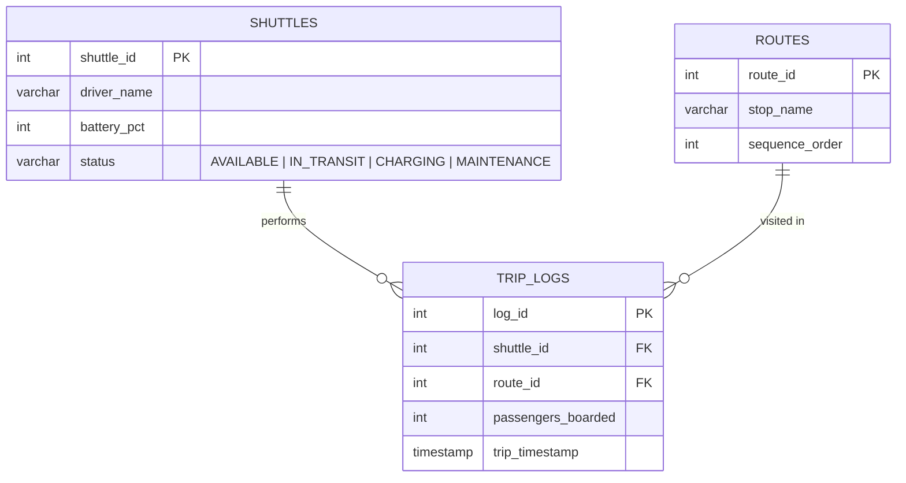

```sql
CREATE TABLE shuttles (
    shuttle_id INT AUTO_INCREMENT PRIMARY KEY,
    driver_name VARCHAR(100) NOT NULL,
    battery_pct INT NOT NULL,
    status VARCHAR(30) NOT NULL
);

CREATE TABLE routes (
    route_id INT AUTO_INCREMENT PRIMARY KEY,
    stop_name VARCHAR(100) NOT NULL,
    sequence_order INT NOT NULL
);

CREATE TABLE trip_logs (
    log_id INT AUTO_INCREMENT PRIMARY KEY,
    shuttle_id INT NOT NULL,
    route_id INT NOT NULL,
    passengers_boarded INT NOT NULL,
    trip_timestamp TIMESTAMP DEFAULT CURRENT_TIMESTAMP,
    CONSTRAINT fk_trip_shuttle FOREIGN KEY (shuttle_id) REFERENCES shuttles(shuttle_id) ON DELETE CASCADE,
    CONSTRAINT fk_trip_route FOREIGN KEY (route_id) REFERENCES routes(route_id) ON DELETE CASCADE
);
```

**Seed data:** 6 shuttles in mixed states, 6 campus stops, and 4 sample trip logs.

</details>


## 🖥️ Live Demo

```text
================================================================================
          ⚡ SMART CAMPUS EV SHUTTLE TRACKER & FLEET ALLOCATION ⚡
                   Spring Core & Spring JDBC Enterprise CLI
================================================================================

  1. [FR-1] Register / Onboard New Shuttle
  2. [FR-1] Fleet Inventory Dashboard (All Shuttles)
  3. [FR-2] View Deployable Shuttles (AVAILABLE & Battery > 20%)
  4. [FR-3] Log Route Trip & Deplete Battery (Auto-Maintenance < 15%)
  5. [FR-4] Multi-Table Joined Fleet Analytics (Trips & Passengers)
  6. [FR-5] Manual Maintenance Flag / Override
  7. Recharge & Release Shuttle from Maintenance
  8. View Campus Routes & Recent Trip Logs
  9. Exit Application
```

<details open>
<summary><b>📸 Screenshots from a real run</b></summary>

<br/>

<table>
<tr>
<td align="center" width="50%"><b>Main menu</b><br/>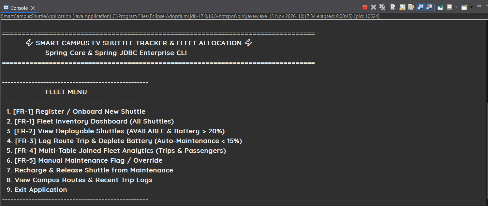</td>
<td align="center" width="50%"><b>FR-1 · Register a shuttle</b><br/>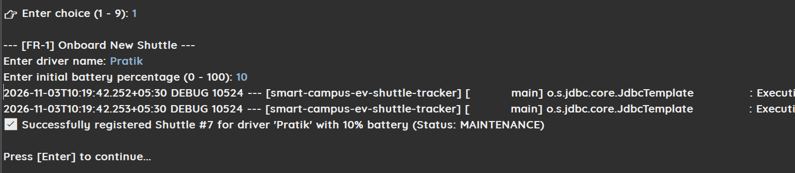</td>
</tr>
<tr>
<td align="center"><b>FR-1 · Fleet inventory</b><br/>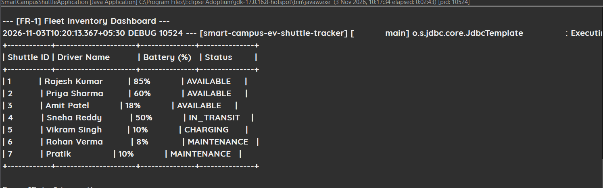</td>
<td align="center"><b>FR-2 · Deployable shuttles</b><br/>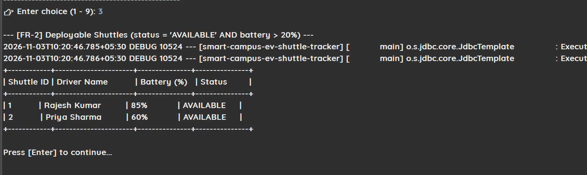</td>
</tr>
<tr>
<td align="center"><b>FR-3 · Dispatch rejected (maintenance)</b><br/>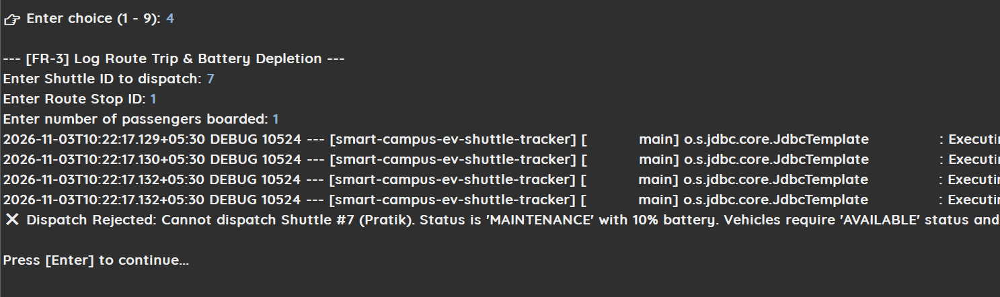</td>
<td align="center"><b>FR-5 · Maintenance override</b><br/>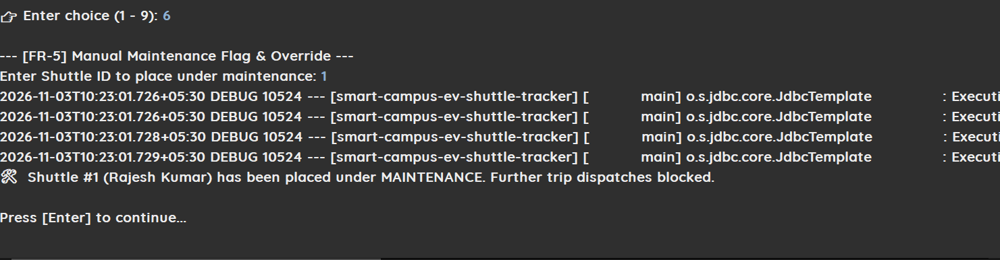</td>
</tr>
<tr>
<td align="center"><b>Campus routes</b><br/>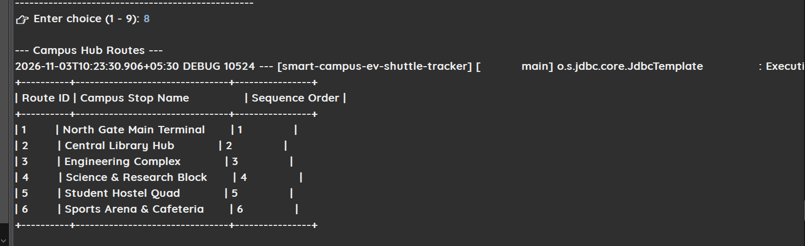</td>
<td align="center"><b>Recent trip logs</b><br/>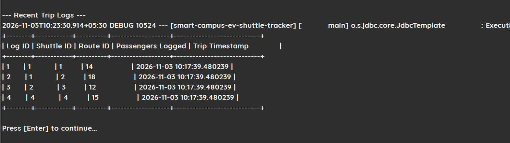</td>
</tr>
</table>

</details>


## 🧪 Testing

Tests run on in-memory H2, so no external setup is needed.

```bash
./mvnw clean test
```

| Test class | Covers |
|---|---|
| `ShuttleDaoTest` | insert, lookup, deployable query, status and battery updates |
| `RouteDaoTest` | route retrieval and insertion |
| `TripLogDaoTest` | trip log persistence and retrieval |
| `FleetServiceTest` | registration, low-battery and non-available rejection, 10% deduction, auto-maintenance trigger, manual maintenance |


## 👥 Meet the Team

<div align="center">

| 👤 Member | 🎯 Role | 🌿 Branch | 🛠️ Contributions |
|---|---|---|---|
| **Utkarsh Tripathi** | Shuttle DAO Specialist & Architecture Lead | `feature/shuttle-dao` / `main` | Multi-layer architecture, models, JDBC DAOs, service automation, console UI, SQL scripts, tests |
| **Pratik Godase** | Project Lead & Initial Scaffolding | `feature/pratik` | Repository initialization, baseline Spring configuration |
| **Varun** | Console Runner & UI Support | `feature/Varun` | Interactive CLI loop and terminal formatting |
| **Atharva** | Route Management | `feature/atharva` | Route data access and stop sequencing |
| **Himanshu** | Analytics & Join Support | `feature/himanshu` | Multi-table joins and aggregation reporting |
| **Omkar** | Business Rules & Validation | `feature/omkar` | Business rule assertions and exception handling |

</div>

See [`team-members.txt`](team-members.txt) for the full summary.

<div align="center">


** Group 1 ⚡**

*If you like this project, give it a ⭐*

</div>