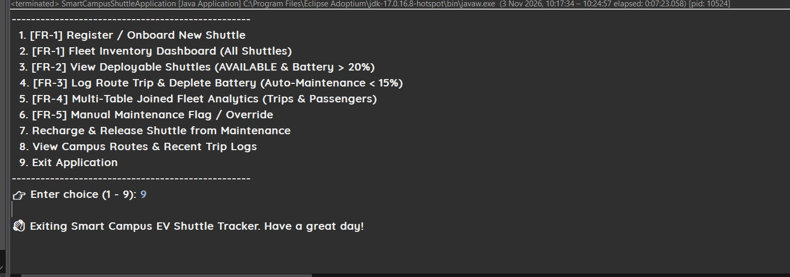

# ⚡ Smart Campus EV Shuttle Tracker (Group 1)

[](https://www.oracle.com/java/)
[](https://spring.io/projects/spring-boot)
[](https://spring.io/)
[](https://www.mysql.com/)
[](https://www.h2database.com/)

A modular console application built on **Spring Core** and **Spring JDBC (`JdbcTemplate`)** to monitor campus electric vehicle (EV) fleets, manage route allocation, record passenger trip logs, and automate fleet maintenance workflows.

> Built for **Spring Mini Hackathon 2026 – Problem Statement #1**.

---

## 📑 Table of Contents

1. [Features](#-features)
2. [Tech Stack](#-tech-stack)
3. [Project Structure](#-project-structure)
4. [Architecture Overview](#-architecture-overview)
5. [Functional Requirements Coverage](#-functional-requirements-coverage)
6. [Business Rules](#-business-rules)
7. [Database Schema](#-database-schema)
8. [Getting Started](#-getting-started)
9. [Testing](#-testing)
10. [Console Menu & Screenshots](#-console-menu--screenshots)
11. [Team Roles & Responsibilities](#-team-roles--responsibilities)

---

## ✨ Features

- Onboard shuttles with a driver name and initial battery level
- Query only *deployable* shuttles (`AVAILABLE` and battery above 20%)
- Log trips against campus route stops with automatic battery depletion
- Auto-move low-battery shuttles into `MAINTENANCE`
- Joined analytics: total trips and passengers per shuttle
- Manual maintenance override and recharge/release workflow
- Runs with **MySQL**, and automatically falls back to an in-memory **H2** database if MySQL is unreachable

---

## 🧰 Tech Stack

| Area | Technology |
|---|---|
| Language | Java 17 |
| Framework | Spring Boot 3.2.5 (Spring Core, Spring JDBC, HikariCP) |
| Data access | `JdbcTemplate`, custom `RowMapper`s, `GeneratedKeyHolder` |
| Database | MySQL 8.x (primary), H2 in MySQL mode (fallback and tests) |
| Build | Maven (wrapper included: `mvnw` / `mvnw.cmd`) |
| Testing | JUnit 5, Spring Boot Starter Test |

---

## 📂 Project Structure

```
Smart-Campus-EV-Shuttle-Tracker---Group-1/
├── pom.xml                                         # Maven build (Spring Boot 3.2.5, Java 17)
├── mvnw / mvnw.cmd                                 # Maven wrapper scripts
├── .mvn/wrapper/maven-wrapper.properties           # Maven wrapper configuration
├── .gitignore
├── README.md
├── team-members.txt                                # Team roster and contribution summary
│
├── Output/                                         # Console run screenshots (Output_1 … Output_10)
│
└── src/
    ├── main/
    │   ├── java/com/campus/shuttle/
    │   │   ├── SmartCampusShuttleApplication.java  # Spring Boot main entry point
    │   │   │
    │   │   ├── config/
    │   │   │   └── DatabaseConfig.java             # DataSource bean: tries MySQL, falls back to H2
    │   │   │
    │   │   ├── model/                              # Domain POJOs and DTOs
    │   │   │   ├── Shuttle.java                    # shuttleId, driverName, batteryPct, status
    │   │   │   ├── Route.java                      # routeId, stopName, sequenceOrder
    │   │   │   ├── TripLog.java                    # logId, shuttleId, routeId, passengersBoarded, timestamp
    │   │   │   ├── ShuttleAnalyticsDTO.java        # Joined analytics result (FR-4)
    │   │   │   └── TripResult.java                 # Trip summary with battery before/after
    │   │   │
    │   │   ├── rowmapper/                          # ResultSet -> object mappers
    │   │   │   ├── ShuttleRowMapper.java
    │   │   │   ├── RouteRowMapper.java
    │   │   │   ├── TripLogRowMapper.java
    │   │   │   └── ShuttleAnalyticsRowMapper.java
    │   │   │
    │   │   ├── dao/                                # Data access layer (JdbcTemplate, parameterized SQL)
    │   │   │   ├── ShuttleDao.java / ShuttleDaoImpl.java
    │   │   │   ├── RouteDao.java / RouteDaoImpl.java
    │   │   │   └── TripLogDao.java / TripLogDaoImpl.java
    │   │   │
    │   │   ├── service/                            # Business logic and rule automation
    │   │   │   ├── FleetService.java
    │   │   │   ├── FleetServiceImpl.java
    │   │   │   └── exception/
    │   │   │       ├── ShuttleNotFoundException.java
    │   │   │       ├── RouteNotFoundException.java
    │   │   │       ├── ShuttleNotDeployableException.java
    │   │   │       └── InvalidTripException.java
    │   │   │
    │   │   └── ui/
    │   │       └── FleetConsoleRunner.java         # Interactive ASCII console menu
    │   │
    │   └── resources/
    │       ├── application.properties              # MySQL connection, SQL init, logging
    │       ├── schema.sql                          # DDL (drops and recreates tables on every start)
    │       └── data.sql                            # Seed shuttles, routes and trip logs
    │
    └── test/
        ├── java/com/campus/shuttle/
        │   ├── dao/
        │   │   ├── ShuttleDaoTest.java
        │   │   ├── RouteDaoTest.java
        │   │   └── TripLogDaoTest.java
        │   └── service/
        │       └── FleetServiceTest.java
        └── resources/
            └── application.properties              # H2 in-memory test configuration
```

---

## 🏛️ Architecture Overview

The project uses strict layered separation of concerns:

```
 ┌────────────────────┐
 │  ui                │  FleetConsoleRunner (console menu, input handling, display)
 └─────────┬──────────┘
           ▼
 ┌────────────────────┐
 │  service           │  FleetService / FleetServiceImpl (rules, validation, @Transactional)
 └─────────┬──────────┘
           ▼
 ┌────────────────────┐
 │  dao + rowmapper   │  JdbcTemplate with parameterized queries
 └─────────┬──────────┘
           ▼
 ┌────────────────────┐
 │  config            │  DatabaseConfig -> MySQL, or H2 fallback
 └────────────────────┘

 model (Shuttle, Route, TripLog, DTOs) is shared across all layers.
```

---

## 📋 Functional Requirements Coverage

| Requirement | Description | Implementation Highlights |
|---|---|---|
| **FR-1: Fleet Onboarding & Inventory** | Register shuttles with driver name and battery percentage; full inventory dashboard. | `FleetService.registerShuttle()` captures auto-increment IDs via `GeneratedKeyHolder`; `getAllShuttles()` for the dashboard. |
| **FR-2: Dynamic Availability Querying** | List deployable vehicles (`status = 'AVAILABLE'` AND `battery_pct > 20`). | Parameterized `WHERE status = ? AND battery_pct > ?`, sorted by highest battery first. |
| **FR-3: Trip Logging & Battery Depletion** | Log completed trips and deduct 10% battery per trip. | Dispatch is validated first; battery drops by 10%; if the result is below **15%** the status automatically becomes `MAINTENANCE`. |
| **FR-4: Multi-Table Joined Analytics** | Show each shuttle with total trips and total passengers. | `LEFT JOIN trip_logs` grouped by shuttle, ordered by trip count, mapped by `ShuttleAnalyticsRowMapper`. |
| **FR-5: Maintenance Flag & Override** | Let dispatchers manually place any vehicle under maintenance. | Sets status to `MAINTENANCE`, which blocks further trip dispatches. |

---

## 📏 Business Rules

| Rule | Value |
|---|---|
| Deployable shuttle | Status `AVAILABLE` **and** battery **> 20%** |
| Battery used per trip | **10%** |
| Auto-maintenance threshold | Battery **< 15%** after a trip |
| Registration | A shuttle registered with battery **< 15%** starts as `MAINTENANCE`; otherwise `AVAILABLE` |
| Valid battery input | 0 – 100 |
| Trip passengers | Must be greater than 0 |
| Recharge & release | New battery must be 21% – 100%; shuttle returns to `AVAILABLE` |

**Custom exceptions:** `ShuttleNotFoundException`, `RouteNotFoundException`, `ShuttleNotDeployableException`, `InvalidTripException`.

---

## 🗄️ Database Schema

Defined in `src/main/resources/schema.sql`, with Primary Keys, Foreign Keys, and cascade deletes:

```sql
-- Table: shuttles
CREATE TABLE shuttles (
    shuttle_id INT AUTO_INCREMENT PRIMARY KEY,
    driver_name VARCHAR(100) NOT NULL,
    battery_pct INT NOT NULL,
    status VARCHAR(30) NOT NULL -- 'AVAILABLE', 'IN_TRANSIT', 'CHARGING', 'MAINTENANCE'
);

-- Table: routes
CREATE TABLE routes (
    route_id INT AUTO_INCREMENT PRIMARY KEY,
    stop_name VARCHAR(100) NOT NULL,
    sequence_order INT NOT NULL
);

-- Table: trip_logs
CREATE TABLE trip_logs (
    log_id INT AUTO_INCREMENT PRIMARY KEY,
    shuttle_id INT NOT NULL,
    route_id INT NOT NULL,
    passengers_boarded INT NOT NULL,
    trip_timestamp TIMESTAMP DEFAULT CURRENT_TIMESTAMP,
    CONSTRAINT fk_trip_shuttle FOREIGN KEY (shuttle_id) REFERENCES shuttles(shuttle_id) ON DELETE CASCADE,
    CONSTRAINT fk_trip_route FOREIGN KEY (route_id) REFERENCES routes(route_id) ON DELETE CASCADE
);
```

**Seed data (`data.sql`):** 6 shuttles in mixed states (available, low battery, in transit, charging, maintenance), 6 campus stops (North Gate Main Terminal → Sports Arena & Cafeteria), and 4 sample trip logs.

---

## 🚀 Getting Started

### Prerequisites

- JDK 17
- MySQL 8.x *(optional, the app falls back to in-memory H2 if MySQL is unavailable)*

### 1. Configure the database (optional)

Create the database:

```sql
CREATE DATABASE IF NOT EXISTS shuttle_tracker;
```

Check the credentials in `src/main/resources/application.properties` and change them to match your setup:

```properties
spring.datasource.url=jdbc:mysql://localhost:3306/shuttle_tracker?useSSL=false&serverTimezone=UTC&allowPublicKeyRetrieval=true
spring.datasource.username=root
spring.datasource.password=root
```

Spring Boot runs `schema.sql` and `data.sql` on every startup (`spring.sql.init.mode=always`).

> ⚠️ `schema.sql` **drops and recreates** all tables on each run, so any data you add in a session is reset the next time the app starts.

> ℹ️ **No MySQL? No problem.** `DatabaseConfig` waits about 2 seconds for MySQL, then switches to an in-memory H2 database (`jdbc:h2:mem:shuttle_tracker`, MySQL mode) and runs the same scripts. The console log shows which database was used.

### 2. Run the application

```bash
./mvnw spring-boot:run        # macOS / Linux
mvnw.cmd spring-boot:run      # Windows (cmd)
```

You can also run `SmartCampusShuttleApplication` directly from your IDE (Eclipse, IntelliJ, or VS Code).

### 3. Build a runnable JAR (optional)

```bash
./mvnw clean package
java -jar target/smart-campus-ev-shuttle-tracker-1.0.0-SNAPSHOT.jar
```

---

## 🧪 Testing

Tests use an in-memory H2 database (`src/test/resources/application.properties`), so no external setup is needed.

```bash
./mvnw clean test
```

| Test class | Focus |
|---|---|
| `ShuttleDaoTest` | Insert, lookup, deployable query, status and battery updates |
| `RouteDaoTest` | Route retrieval and insertion |
| `TripLogDaoTest` | Trip log persistence and retrieval |
| `FleetServiceTest` | Registration, low-battery rejection, non-available rejection, 10% battery deduction, auto-maintenance trigger, manual maintenance |

---

## 🖥️ Console Menu & Screenshots

```text
================================================================================
          ⚡ SMART CAMPUS EV SHUTTLE TRACKER & FLEET ALLOCATION ⚡
                   Spring Core & Spring JDBC Enterprise CLI
================================================================================

--------------------------------------------------
                   FLEET MENU
--------------------------------------------------
  1. [FR-1] Register / Onboard New Shuttle
  2. [FR-1] Fleet Inventory Dashboard (All Shuttles)
  3. [FR-2] View Deployable Shuttles (AVAILABLE & Battery > 20%)
  4. [FR-3] Log Route Trip & Deplete Battery (Auto-Maintenance < 15%)
  5. [FR-4] Multi-Table Joined Fleet Analytics (Trips & Passengers)
  6. [FR-5] Manual Maintenance Flag / Override
  7. Recharge & Release Shuttle from Maintenance
  8. View Campus Routes & Recent Trip Logs
  9. Exit Application
--------------------------------------------------
👉 Enter choice (1 - 9):
```

### Sample run

| Screen | Screenshot |
|---|---|
| Main menu |  |
| FR-1: Register a shuttle (a 10% battery shuttle starts in `MAINTENANCE`) |  |
| FR-1: Fleet inventory dashboard |  |
| FR-2: Deployable shuttles only |  |
| FR-3: Dispatch rejected for a shuttle in maintenance |  |
| FR-5: Manual maintenance override |  |
| Campus hub routes |  |
| Recent trip logs |  |
| Menu and clean exit |  |

---

## 👥 Team Roles & Responsibilities

| Member | Role | Branch | Completed Contributions |
|---|---|---|---|
| **Utkarsh Tripathi** | Shuttle DAO Specialist & Architecture Lead | `feature/shuttle-dao` / `main` | End-to-end multi-layer architecture, domain models, Spring JDBC DAOs, service layer automation, console UI, SQL scripts, and test suite |
| **Pratik Godase** | Project Lead & Initial Repository Scaffolding | `feature/pratik` | Repository initialization, baseline Spring configuration |
| **Varun** | Console Runner & UI Support | `feature/Varun` | Fleet interactive CLI loop and terminal display formatting |
| **Atharva** | Route Management | `feature/atharva` | Route data access and stop sequencing |
| **Himanshu** | Analytics & Join Support | `feature/himanshu` | Multi-table joins and aggregation reporting |
| **Omkar** | Business Rules & Validation Support | `feature/omkar` | Business rule assertions and exception handling |

See [`team-members.txt`](team-members.txt) for the full contribution summary.