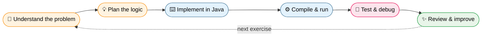

<!-- ═══════════════════ HEADER BANNER ═══════════════════ -->
<p align="center">
  
</p>

<p align="center">
  <a href="https://git.io/typing-svg">
    
  </a>
</p>

<p align="center">
  
  
  
  
</p>

<p align="center">
  
  
  
  
</p>

<p align="center">
  <a href="#-overview">Overview</a> •
  <a href="#-learning-objectives">Objectives</a> •
  <a href="#-topics-practised">Topics</a> •
  <a href="#-repository-structure">Structure</a> •
  <a href="#-getting-started">Get Started</a> •
  <a href="#-my-practice-approach">Approach</a> •
  <a href="#-about-me">About Me</a>
</p>

---

## 📖 Overview

> **PMIS** is my Java internship practice repository — a living notebook of code.

Rather than a single standalone application, PMIS is a **collection of practical coding exercises and learning activities**. It documents my hands-on journey during my internship: solving programming problems, completing training exercises, experimenting with Java concepts, and practising how to write effective code.

Each exercise is a chance to:

| 🧠 Understand | 🐞 Debug | ✍️ Improve |
|:---:|:---:|:---:|
| Concepts more deeply | Errors and edge cases | Logic and coding habits |

---

## 🎯 Learning Objectives

- [x] Strengthen Java programming fundamentals through hands-on practice
- [x] Build a clear understanding of **Object-Oriented Programming (OOP)**
- [x] Improve logical thinking and problem-solving skills
- [x] Practise writing, compiling, executing, and debugging Java programs
- [x] Learn concepts through small, practical examples
- [x] Keep a record of completed exercises and progress
- [x] Build consistent **Git & GitHub** version-control habits

---

## 🧩 Topics Practised

The repository evolves as I progress through internship and programming exercises.

<table>
  <tr>
    <td width="50%" valign="top">

### 🔹 Fundamentals
- ☕ Java syntax, variables & data types
- ➕ Operators & control-flow statements
- 🔁 Loops & pattern-printing problems
- 🛠️ Methods & constructors

    </td>
    <td width="50%" valign="top">

### 🔸 Object-Oriented Programming
- 🏗️ Classes & objects
- 🔒 Encapsulation
- 🧬 Inheritance
- 🎭 Polymorphism
- 🧱 Abstraction

    </td>
  </tr>
  <tr>
    <td width="50%" valign="top">

### 🔹 Data Handling
- 📚 Arrays
- 🔤 Strings

    </td>
    <td width="50%" valign="top">

### 🔸 Robustness & More
- 🚨 Exception handling
- 🌱 Other Java concepts as learning progresses

    </td>
  </tr>
</table>

> [!NOTE]
> Topics listed here are the **intended learning areas**. A topic is marked as completed only when the corresponding exercises are present in the repository.

---

## 🗂️ Repository Structure

```text
PMIS/
├── 📄 README.md
├── 🚫 .gitignore
├── ☕ Java practice programs
├── 🧱 OOP exercises
└── 🎓 Internship training exercises
```

> The structure above is illustrative. Actual folders and files may differ as the repository grows.

---

## 🚀 Getting Started

### 🧰 Prerequisites

| Tool | Purpose |
|---|---|
|  | Compile and run Java programs |
|  | Version control |
|  | Write code |

Verify your Java installation:

```bash
java -version
javac -version
```

### 📥 Clone the Repository

```bash
git clone https://github.com/pratikgodase07/PMIS.git
cd PMIS
```

### ▶️ Compile and Run a Java Program

Navigate to the folder containing the source file, then:

```bash
javac Example.java
java Example
```

> Replace `Example` with your actual file and class name. These commands apply to simple programs **without** package declarations or external dependencies.

---

## 🔄 My Practice Approach



This loop turns theoretical knowledge into practical programming skill.

---

## 🔀 Version Control

Git and GitHub help me track progress and keep a history of my practice work.

```bash
git status
git add .
git commit -m "Add Java practice exercises"
git push origin main
```

<details>
<summary><b>✅ My pre-commit checklist (click to expand)</b></summary>

<br>

- Review the changed files
- Don't commit generated `.class` files
- Don't commit unrelated files
- Write a clear, meaningful commit message

</details>

---

## 🏁 Long-Term Goals

<table>
  <tr>
    <td align="center">☕<br><b>Strong core Java</b></td>
    <td align="center">🧱<br><b>Confident in OOP</b></td>
    <td align="center">⚡<br><b>Faster, accurate problem solving</b></td>
  </tr>
  <tr>
    <td align="center">🧹<br><b>Clean, readable code</b></td>
    <td align="center">🏛️<br><b>Solid Java foundation</b></td>
    <td align="center">🎤<br><b>Technical interview ready</b></td>
  </tr>
</table>

---

## 👨‍💻 About Me

<p align="center">
  <b>Pratik Godase</b><br>
  <i>Computer Science & Engineering Graduate • Java Intern • Aspiring Software Developer</i>
</p>

<p align="center">
  <a href="https://github.com/pratikgodase07">
    
  </a>
</p>

<p align="center">
  
  
</p>

<p align="center">
  
</p>

---

<p align="center">
  <b>⭐ If you find this repo useful, consider giving it a star!</b>
</p>

<p align="center">
  <sub>Learn by doing. Practise consistently. Improve with every commit.</sub>
</p>

<p align="center">
  
</p>