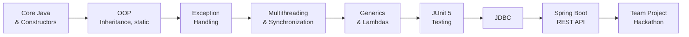

<p align="center">
  
</p>

<p align="center">
  
  
  
  
  
</p>

<p align="center">
  
  
  
</p>

<p align="center">
  <a href="#overview">Overview</a> •
  <a href="#highlights">Highlights</a> •
  <a href="#learning-journey">Journey</a> •
  <a href="#repository-map">Repository Map</a> •
  <a href="#getting-started">Get Started</a> •
  <a href="#about-me">About</a>
</p>

---

## Overview

**PMIS** is a day-by-day log of my Java internship: core Java and OOP exercises, a JDBC demo, a Spring Boot REST API, a team hackathon project, and 40+ algorithm problems from LeetCode and HackerRank.

It is not a single application. Each folder is a self-contained topic or day, so you can open any one of them and run it on its own.

| | |
|---|---|
| **Language** | Java 17 (plus a few SQL solutions) |
| **Frameworks** | Spring Boot, Spring JDBC, JUnit 5 |
| **Database** | MySQL via JDBC, H2 for tests |
| **Build** | Maven (wrapper included in the Spring projects), or plain `javac` for single files |

---

## Highlights

| Project | What it is | Stack |
|---|---|---|
| [**Smart Campus EV Shuttle Tracker**](November_2nd/Smart-Campus-EV-Shuttle-Tracker---Group-1) | Team project from the Spring Mini Hackathon 2026. Tracks a campus EV fleet, logs trips, and automatically flags low-battery shuttles for maintenance. Layered design: model, DAO, service, console UI, with unit tests. | Spring Boot 3.2.5, Spring JDBC, MySQL, H2, JUnit 5 |
| [**Student API**](october_29th/studentAPI/studentAPI) | REST API for student records using the Controller → Service → Repository pattern. | Spring Boot, Maven |
| [**JDBC Demo**](october_23th/JDBC) | Connecting Java to a database, plus date and time handling. | JDBC |
| [**JUnit 5 Testing**](october_19th/J%20Unit5) | Annotations, assertions, lifecycle methods, parameterized tests, exception testing. | JUnit 5 |
| [**LeetCode Solutions**](LeetCode/LeetCode) | 25 solved problems, each with its own folder and problem README. Includes 3 SQL queries. | Java, SQL |

---

## Learning Journey



| Date folder | Topic | What's inside |
|---|---|---|
| [`Basic Excercise`](Basic%20Excercise) | Java basics | Exercises 1–10 |
| [`october_8th`](october_8th) | Constructors, inheritance | Banking system, inheritance demo |
| [`october_9th`](october_9th/inheritance) | Inheritance in depth | Multilevel, multiple (via interfaces), hierarchical, `super` keyword |
| [`october_12th`](october_12th) | `static` and relationships | Static demo, bank exercise, class relationships |
| [`october_13th`](october_13th/exception_handling) | Exception handling | `throw`, `throws`, `finally`, `ArrayIndexOutOfBounds` |
| [`october_14th`](october_14th) | Concurrency | Threads, thread life cycle, synchronization |
| [`october_15th`](october_15th/Generics) | Generics | Generic classes, multiple type parameters |
| [`october_16th`](october_16th) | Functional Java | Lambda expressions, `Consumer` and functional interfaces |
| [`october_19th`](october_19th/J%20Unit5) | Unit testing | JUnit 5 |
| [`october_23th`](october_23th/JDBC) | Databases | JDBC connection, date and time |
| [`october_29th`](october_29th/studentAPI/studentAPI) | REST | Student API with Spring Boot |
| [`November_2nd`](November_2nd/Smart-Campus-EV-Shuttle-Tracker---Group-1) | Team project | Smart Campus EV Shuttle Tracker |
| `November_4th`, `November_6th`, `November_12th` | Problem solving | HackerRank problems with screenshots of each question |

---

## Repository Map

```text
PMIS/
├── Basic Excercise/          # Java fundamentals, exercises 1-10
├── october_8th ... 29th/     # Daily topics: OOP, exceptions, threads, generics,
│                             #   lambdas, JUnit 5, JDBC, Spring Boot REST
├── November_2nd/             # Smart Campus EV Shuttle Tracker (team project)
├── November_4th, 6th, 12th/  # HackerRank solutions + question screenshots
├── hackerrank/               # Earlier HackerRank solutions (polymorphism, patterns, etc.)
└── LeetCode/LeetCode/        # 25 LeetCode solutions, one folder per problem
```

Each HackerRank and LeetCode problem sits in its own folder with a `Solution.java` (or `<problem-name>.java`) and the problem statement.

---

## Getting Started

**Prerequisites:** JDK 17 or later and Git. Maven is optional, since the Spring projects ship with a Maven wrapper.

```bash
java -version      # should report 17 or later
git clone https://github.com/pratikgodase07/PMIS.git
cd PMIS
```

### Run a single-file exercise

```bash
cd "Basic Excercise"
javac Exercise_1.java
java Exercise_1
```

This works for files with no `package` declaration and no external dependencies. Files in packages should be compiled from their source root.

### Run a Spring Boot project

```bash
cd November_2nd/Smart-Campus-EV-Shuttle-Tracker---Group-1
./mvnw spring-boot:run      # on Windows: mvnw.cmd spring-boot:run
./mvnw test                 # run the unit tests
```

The shuttle tracker uses MySQL and can fall back to an embedded H2 database. See its [own README](November_2nd/Smart-Campus-EV-Shuttle-Tracker---Group-1/README.md) for configuration, architecture, and business rules. `october_29th/studentAPI/studentAPI` runs the same way.

---

## Conventions

- One folder per day or topic, with problems in their own subfolders.
- Compiled `.class` and `.log` files are ignored through `.gitignore`.
- Commit messages describe the exercise added, for example `Add HackerRank Goat Latin solution`.

---

## About Me

**Pratik Godase** is a Computer Science graduate and Java intern who is moving toward full-stack development. This repository is where I practise consistently and keep a record of what I learn.

[](https://github.com/pratikgodase07)

<p align="center">
  <sub>Learn by doing. Practise consistently. Improve with every commit.</sub>
</p>

<p align="center">
  
</p>