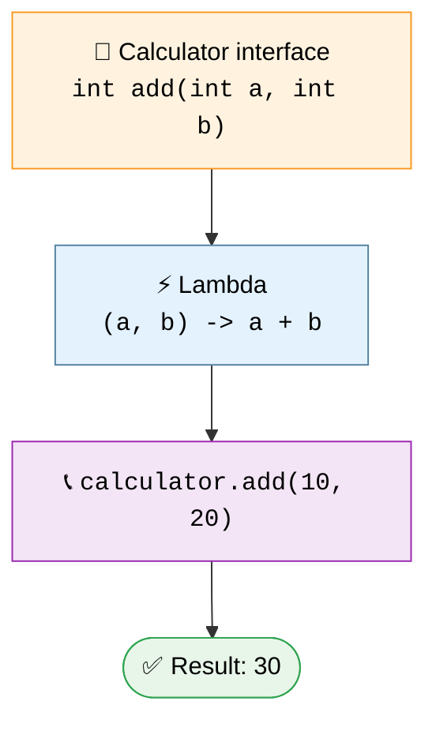

<!-- ═══════════════════ HEADER ═══════════════════ -->
<p align="center">
  
</p>

<p align="center">
  <a href="https://git.io/typing-svg">
    
  </a>
</p>

<p align="center">
  
  
  
  
</p>

<p align="center">
  <a href="#-about-this-module">About</a> •
  <a href="#-1-what-is-a-lambda-expression">What is it?</a> •
  <a href="#-2-lambda-syntax">Syntax</a> •
  <a href="#-3-functional-interfaces">Interfaces</a> •
  <a href="#-4-types-of-lambda-expressions">Types</a> •
  <a href="#-6-anonymous-class-vs-lambda">Compare</a> •
  <a href="#-9-how-to-run-the-programs">Run</a> •
  <a href="#-10-key-takeaways">Takeaways</a>
</p>

---

## 📌 About This Module

This module is part of my **PMIS internship training and daily Java practice**. It covers **Java Lambda Expressions**, a feature introduced in **Java 8** that makes it easier to implement functional interfaces with concise, readable code.

> 🎯 **Goal:** understand how lambdas work, why they're useful, and how they simplify traditional Java implementations.

---

## 🧠 1. What Is a Lambda Expression?

A **Lambda Expression** is a concise way to provide an implementation of a functional interface **without writing a separate named implementation class**.

> 💬 *In simple words: a lambda lets us write the implementation of a single abstract method in a shorter way.*

### 🔄 Before vs. After

<table>
<tr>
<th width="50%">🐢 Traditional — Anonymous Class</th>
<th width="50%">⚡ Modern — Lambda Expression</th>
</tr>
<tr>
<td>

```java
Runnable task = new Runnable() {
    @Override
    public void run() {
        System.out.println("Hello Java!");
    }
};

task.run();
```

</td>
<td>

```java
Runnable task = () -> {
    System.out.println("Hello Java!");
};

task.run();
```

</td>
</tr>
</table>

**Output**

```text
Hello Java!
```

> [!TIP]
> The lambda version is shorter because Java **infers** which method is being implemented from the target type, `Runnable`.

---

## 🔍 2. Lambda Syntax

```java
(parameters) -> expression
```

Or, when multiple statements are needed:

```java
(parameters) -> {
    // Statements
};
```

### 🧬 Anatomy of a lambda

```text
       (a, b)       ->       a + b
          │          │          │
          ▼          ▼          ▼
      Parameters   Lambda     Method
                   operator   body
```

| Part | Meaning |
|:---:|---|
| `(a, b)` | 📥 Input parameters |
| `->` | ➡️ Lambda operator (separates input from implementation) |
| `a + b` | 📤 Expression or method body |

---

## 🧩 3. Functional Interfaces

A **functional interface** has **exactly one abstract method**. It may also contain default and static methods. Lambdas are commonly used to implement them.

```java
@FunctionalInterface
interface Calculator {
    int add(int a, int b);
}
```

Using a lambda:

```java
public class LambdaExample {
    public static void main(String[] args) {
        Calculator calculator = (a, b) -> a + b;

        System.out.println(calculator.add(10, 20));
    }
}
```

**Output**

```text
30
```

### 🗺️ How it works



Here, `(a, b) -> a + b` provides the implementation of the `add()` method.

---

## ⚙️ 4. Types of Lambda Expressions

| # | Type | Example |
|:---:|---|---|
| **A** | 0️⃣ No parameters | `() -> System.out.println("Welcome to Java");` |
| **B** | 1️⃣ One parameter | `name -> System.out.println(name);` |
| **C** | 🔢 Multiple parameters | `(a, b) -> a + b;` |
| **D** | 📦 Multiple statements | *(see below)* |

```java
(a, b) -> {
    int sum = a + b;
    return sum;
};
```

> [!NOTE]
> - Parentheses around a **single parameter** are optional when its type is inferred.
> - When a block body needs to return a value, use an explicit `return` statement.

---

## 💻 5. Practical Example: `Runnable`

`Runnable` has a single abstract method, `run()`, so a lambda can implement it.

```java
public class Lambda {
    public static void main(String[] args) {
        Runnable runnable = () ->
            System.out.println("Learning Lambda Expressions");

        runnable.run();
    }
}
```

**Output**

```text
Learning Lambda Expressions
```

> [!WARNING]
> Calling `run()` directly executes the method on the **current thread**. It does **not** start a new thread.

---

## 🆚 6. Anonymous Class vs. Lambda

| Feature | 🐢 Anonymous Class | ⚡ Lambda Expression |
|---|---|---|
| **Syntax** | More verbose | Concise |
| **Best suited for** | Anonymous class implementations | Functional interface implementations |
| **`this` reference** | Refers to the anonymous class instance | Refers to the enclosing context |
| **Abstract methods** | Can implement multiple interface methods | Implements one functional-interface abstract method |

> [!IMPORTANT]
> Lambda expressions do **not** replace every anonymous class. They are designed for **functional-interface** implementations.

---

## 🚀 7. Why Are Lambda Expressions Useful?

<table>
  <tr>
    <td align="center" width="20%">✂️<br><b>Less boilerplate</b><br><sub>Fewer lines per implementation</sub></td>
    <td align="center" width="20%">👓<br><b>Readability</b><br><sub>Simple behavior, clearly expressed</sub></td>
    <td align="center" width="20%">🧮<br><b>Functional style</b><br><sub>Works naturally with functional interfaces</sub></td>
    <td align="center" width="20%">📚<br><b>Collections & Streams</b><br><sub>Filter, transform, process data</sub></td>
    <td align="center" width="20%">📞<br><b>Callbacks</b><br><sub>Pass behavior to methods</sub></td>
  </tr>
</table>

Example with a collection:

```java
import java.util.Arrays;
import java.util.List;

public class LambdaDemo {
    public static void main(String[] args) {
        List<String> names =
            Arrays.asList("Amit", "Pratik", "Neha");

        names.forEach(name -> System.out.println(name));
    }
}
```

**Output**

```text
Amit
Pratik
Neha
```

The `forEach()` method accepts a `Consumer` functional interface, which the lambda implements.

---

## 🧰 8. Common Built-in Functional Interfaces

Java ships with ready-to-use functional interfaces in `java.util.function`:

| Interface | Abstract method | Takes → Returns | Quick example |
|---|---|:---:|---|
| `Runnable` | `run()` | nothing → nothing | `() -> System.out.println("Hi")` |
| `Consumer<T>` | `accept(T t)` | `T` → nothing | `s -> System.out.println(s)` |
| `Predicate<T>` | `test(T t)` | `T` → `boolean` | `n -> n > 18` |
| `Function<T, R>` | `apply(T t)` | `T` → `R` | `s -> s.length()` |
| `Supplier<T>` | `get()` | nothing → `T` | `() -> "Hello"` |

<details>
<summary><b>👀 Click to see a quick Predicate and Function demo</b></summary>

<br>

```java
import java.util.function.Function;
import java.util.function.Predicate;

public class BuiltInDemo {
    public static void main(String[] args) {
        Predicate<Integer> isAdult = age -> age >= 18;
        Function<String, Integer> length = text -> text.length();

        System.out.println(isAdult.test(20));   // true
        System.out.println(length.apply("Java")); // 4
    }
}
```

**Output**

```text
true
4
```

</details>

---

## 📂 9. Folder Structure

```text
Lambda/
├── 📁 Exercise/
├── ☕ Lambda.java
├── ☕ Lambda1.java
└── 📄 README.md
```

| File | Purpose |
|---|---|
| `Lambda.java` | Lambda expression practice |
| `Lambda1.java` | Additional lambda-related practice |
| `Exercise/` | Directory for related practice tasks |
| `README.md` | Concept explanations, examples, and run instructions |

*The exact contents of each Java file should be checked against the source code.*

---

## ▶️ 10. How to Run the Programs

**Prerequisite:** JDK 8 or later, with `java` and `javac` configured.

```bash
# 1️⃣ Open the terminal in the Lambda folder

# 2️⃣ Compile
javac Lambda.java
javac Lambda1.java

# 3️⃣ Run
java Lambda
java Lambda1
```

> If your classes use package declarations, adjust the compile and run commands accordingly.

---

## 📚 11. Key Takeaways

- [x] Lambda expressions were introduced in **Java 8**
- [x] The `->` operator separates parameters from the body
- [x] Lambdas are used with **functional interfaces**
- [x] A functional interface has **exactly one abstract method**
- [x] Lambdas reduce boilerplate but don't remove the need to understand interfaces
- [x] Widely used with `Runnable`, `Consumer`, `Predicate`, `Function`, and the **Stream API**

### 🧾 Cheat sheet

```java
() -> expression                 // no parameters
x -> expression                  // one parameter
(x, y) -> expression             // multiple parameters
(x, y) -> { statements; return z; }  // block body
```

---

## 👨‍💻 Author

<p align="center">
  <b>Pratik Godase</b><br>
  <i>Computer Science and Engineering Graduate • Software Developer</i>
</p>

<p align="center">
  <a href="https://github.com/pratikgodase07">
    
  </a>
  <a href="https://github.com/pratikgodase07/PMIS">
    
  </a>
</p>

---

<p align="center">
  <b>Keep Learning • Keep Coding • Keep Improving</b>
</p>

<p align="center">
  
</p>
